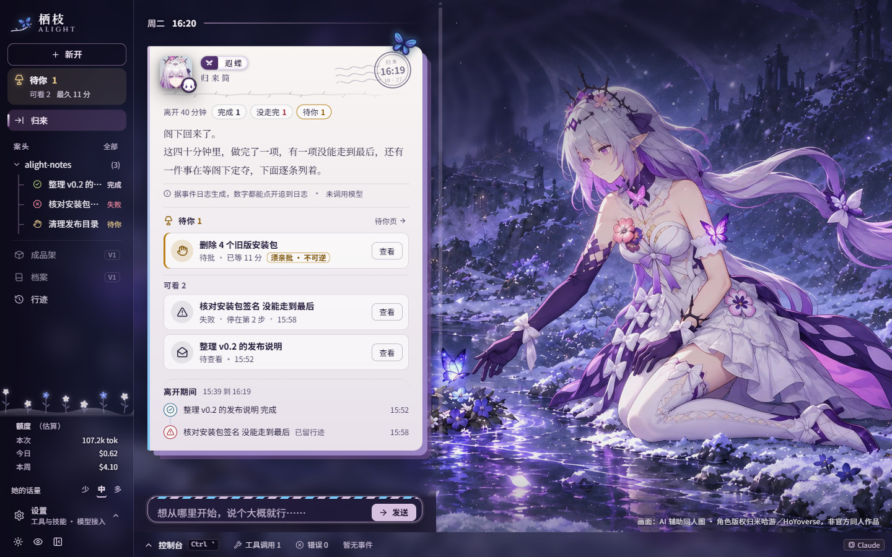
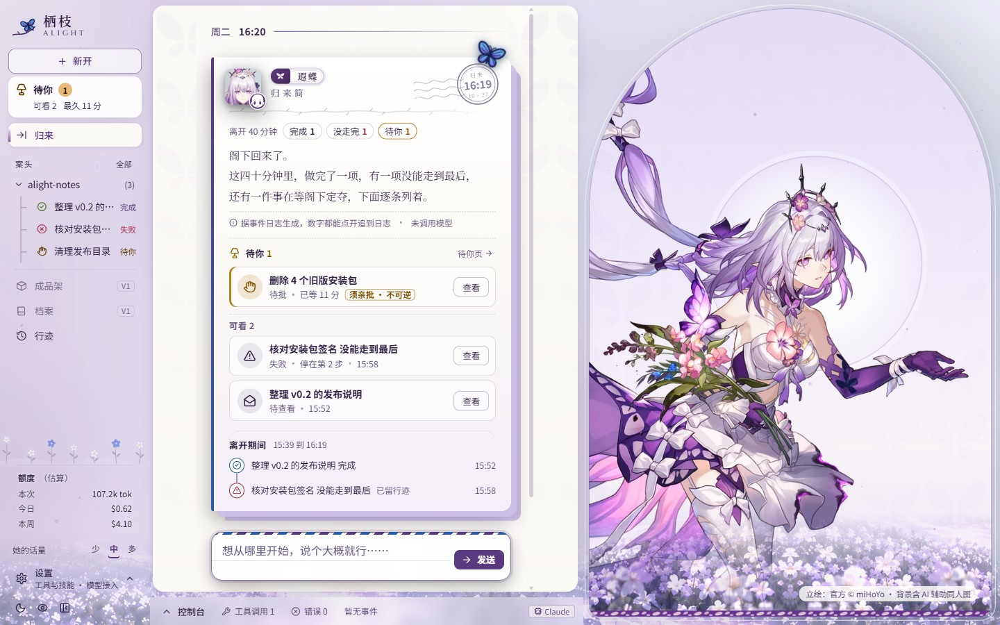
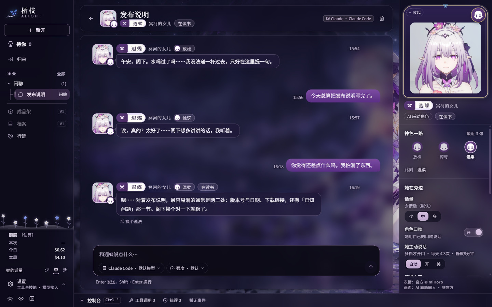
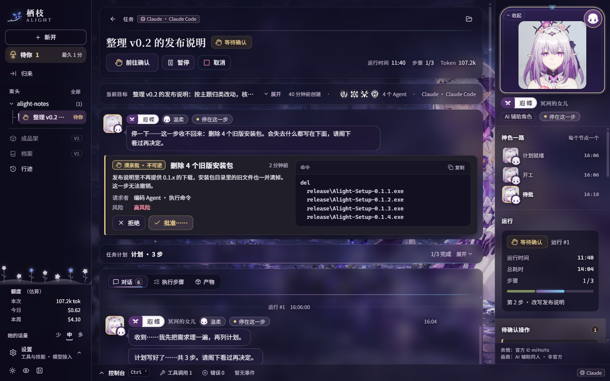
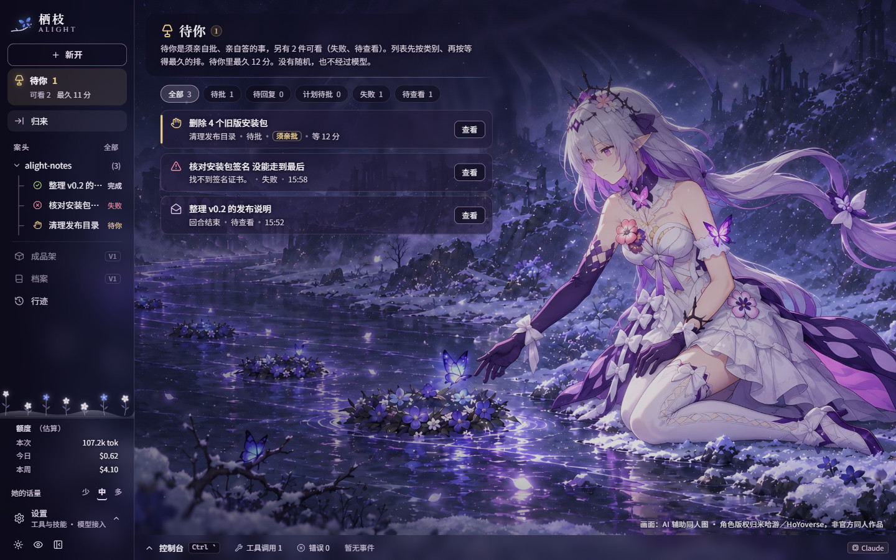
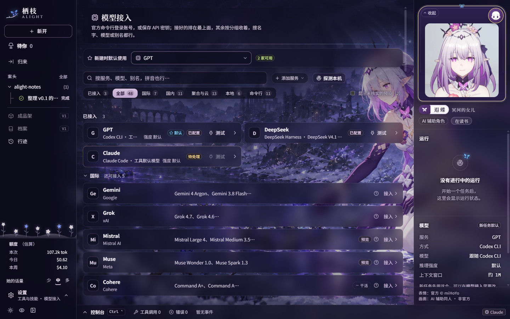
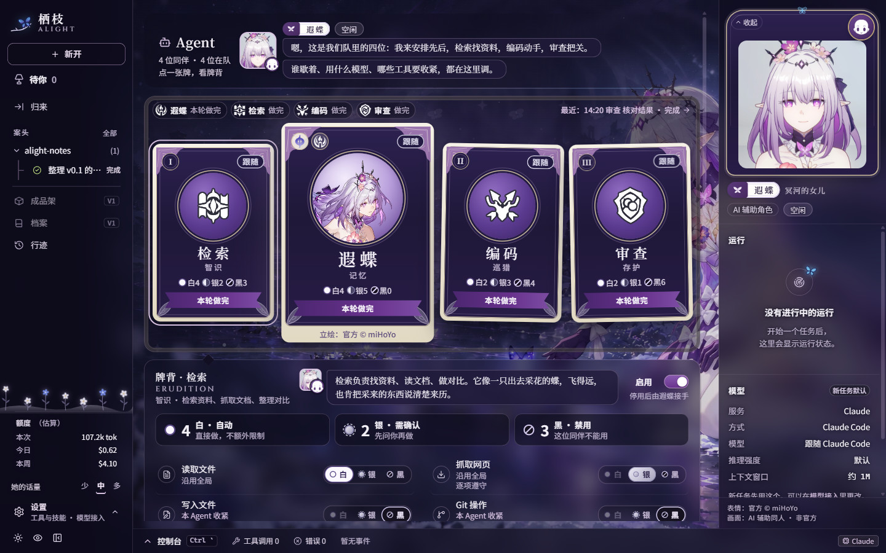
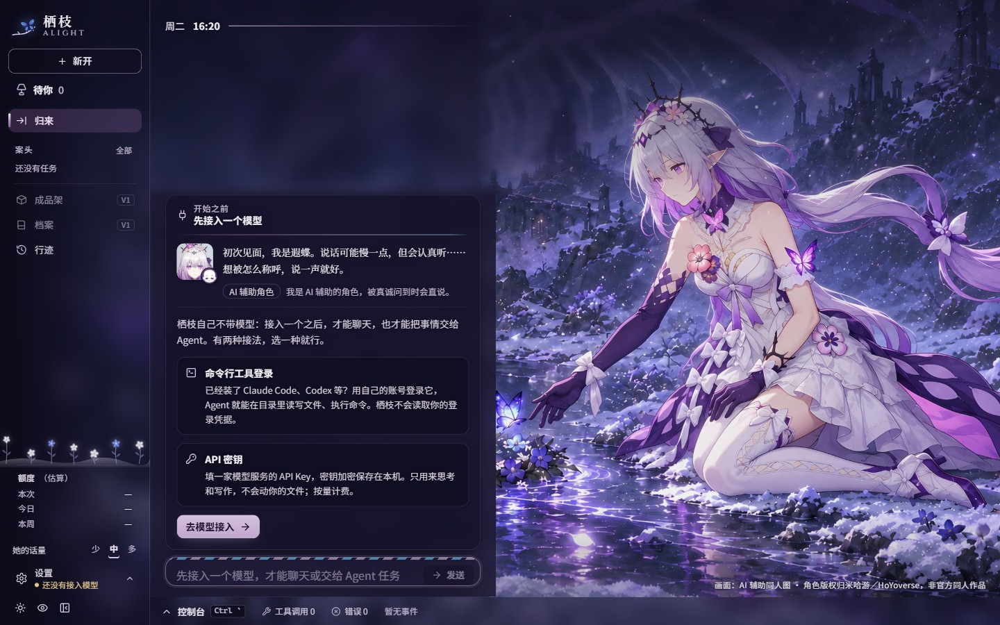

# 栖枝 · Alight

以《崩坏：星穹铁道》角色「遐蝶」为主题的 AI Agent 桌面工作台：把一个目标交给她，她会先给出计划、等你批准，再调用工具一步步做，写文件、执行命令之前按你选的权限模式征求确认；她不在的时候，「待你」队列替你留着需要回应的事，你回来时有一张归来简。可以接入 Claude、GPT、Gemini、DeepSeek、Kimi、Qwen、GLM、MiniMax、豆包等，用命令行工具登录或 API 密钥都行，默认使用你电脑上已经登录的 Claude Code。

> [!IMPORTANT]
> **非官方粉丝同人项目**，与米哈游 / HoYoverse 无任何关联。使用前请阅读 [免责声明与使用条款](DISCLAIMER.md)。
>
> 栖枝自己不带模型，使用前要先接入一个：用 Claude Code、Codex 等命令行工具登录，或填一个 API 密钥（见下方「接入模型」）。界面里的回复、计划、工具调用、终端输出和用量，都来自你接入的模型和命令行工具的真实运行。



## 下载

到 [Releases](https://github.com/xtdf0224-boop/castorice-harness/releases) 下载（Windows 10 / 11，64 位）：

| 文件 | 说明 |
| --- | --- |
| `Alight-Setup-x.y.z.exe` | 安装版：中文安装向导，先阅读并同意条款；默认安装给当前用户，不需要管理员权限；可选安装目录；创建桌面与开始菜单快捷方式「栖枝」。卸载时让你选「留存」（只卸载程序，数据保留，重装后自动接上）或「放下」（同时删除数据，要再核对勾选一次才会删） |
| `Alight-x.y.z-portable.exe` | 便携版：免安装，双击即用，与安装版共用同一份数据 |

安装包没有代码签名，Windows SmartScreen 可能提示「已保护你的电脑」，点「更多信息 → 仍要运行」即可。数据只保存在本机：任务、会话和设置在 `%APPDATA%\alight-desk` 下的 SQLite 库 `alight.db` 里（可在「设置 › 数据与备份」改到别的盘，也能备份），API 密钥由系统加密后另存在同一个用户数据目录，栖枝不会把它们上传到作者的任何服务器。

## 截图

| 归来（昼） | 闲聊 |
| --- | --- |
|  |  |
| **工作（计划 → 执行 → 总结）** | **待你** |
|  |  |
| **模型接入** | **Agent：命途牌桌** |
|  |  |
| **第一次打开：先接入模型** | **开屏标题画面** |
|  |  |

## 功能

- **归来**：首页是「归来」：离开了多久、期间发生了什么、等你的事、最近的会话；底部的输入框写着「寄往 目录 · 引擎 · 手套（权限模式）」，闲聊还是工作由你选，不靠模型猜。归来简里的数字都来自运行记录，不调用模型；键盘和鼠标一段时间没有动、再回来才会写这张笺，多久算「离开」可以在设置里调（5 分钟到 2 小时，默认 30 分钟）。
- **待你**：待批、待回复、计划待批、失败、待查看（回合结束）五类，在行内就能处理。左栏的数字、任务栏角标和系统通知用的是同一份清单，顺序是类别在前、等得最久的在前，没有随机，也不经过模型。高风险的批准要点两次，批准没有任何单键或全局快捷键。
- **闲聊**：无工具、不动文件，只寄往一个引擎。她的回复可以复制、重新生成，也能点「让她换个说法」：只重写她这一句，不会重新做事。她的一句话配官方表情头像；闲聊里默认用「剧情框」（游戏对话框的样子）显示最新一句，可以在设置里关掉。
- **工作**：目录、引擎、权限模式（逐项确认 / 接受编辑 / 先出计划 / 自动 / 放手）都要定。Agent 先出计划，等你批准（可以改一改，也可以带一句意见发回重做）才开始；然后分步执行，最后总结并给出产物（报告、文件、差异）。写文件、执行命令这类操作出现在「待你」里等你批准；模型的提问变成问题卡；运行中可以暂停、继续、取消，失败后可以从失败处重试或从头运行，也可以选「放下」，之后不再催你重试。
- **信任阶梯**：新选的工作目录默认只读，在确认框里点「这是我自己的目录」后才可写、可运行命令；磁盘根和用户主目录范围太大，不能整体信任。第三方克隆的仓库（路径里有 `vendor`、`node_modules` 等，或远端不在你信任过的账号里，或带会执行命令的 git / MCP 配置）会被识别出来，要再勾一下确认。仓库自带的钩子、MCP 与技能配置不会被加载。栖枝自己建的练习目录不用确认。
- **Agent：命途牌桌**：「Agent」页是一张塔罗牌桌：遐蝶（编排）是放大的主牌，宽屏时一排四张，检索 / 编码 / 审查三张小牌在她两侧，牌面写着此刻在做的步骤。翻到牌背，能看到所用模型、统计和近 7 天完成步骤的小柱，也可以给每个 Agent 单独选模型、推理强度，并逐个工具设「自动 / 需确认 / 禁用」，只能比全局设置收紧、不能放宽；扣牌就是停用，停用后由遐蝶接手它的步骤。各引擎是否真的遵守某个工具设置，牌上如实标注。
- **具体模型与推理强度**：输入框里选引擎、模型和推理强度，「⋯」里选参与的 Agent、读写范围（只读）、浏览器和技能；推理强度只列所选模型支持的档位。每个服务有两个默认强度（API 方式一个、命令行方式一个），在「模型接入」里设置。
- **自定义技能**：导入自己写的技能（带 `SKILL.md` 的文件夹，和 Claude Code、DeepSeek Harness 的格式相同），Agent 会在合适的时候照着做。见下方「自定义技能」。
- **浏览器控制**：工作任务打开「浏览器」后，命令行 Agent 可以操作独立的「栖枝浏览器」窗口。见下方「浏览器控制」。
- **桌宠**：在设置里打开，Q 版的她待在屏幕角落，可以陪你打游戏、聊天、一起玩小游戏。默认关闭。见下方「桌宠」。
- **额度**：左栏的额度条显示本次、今日、本周的花费，一律标「估算」：是引擎报告的 API 等价费用，不是账单，订阅登录的账号不会按这个数字扣费。用量只存数字，不存内容。
- **行迹与任务列表**：行迹按状态筛选所有运行，任务列表列出全部任务；右侧状态面板显示运行时间、活跃 Agent、所用模型、上下文和 Token。
- **控制台**（Ctrl + `）：工具调用（输入 / 输出 / 耗时 / 错误）、终端输出、错误、事件时间线。其他快捷键见「设置 › 快捷键」，例如 Alt + 数字切换页面、Ctrl + N 新开一件事、Ctrl + , 打开设置。
- **系统托盘**：点窗口的关闭按钮，栖枝缩小到系统托盘，运行中的任务继续进行（可以改成关闭即退出）。托盘菜单可以打开窗口、新建任务、打开栖枝浏览器、显示 / 隐藏桌宠或退出；窗口不在前台时，有事等你会弹出系统通知。
- **输入法友好**：拼音候选还没有上屏时，回车是选字、Esc 是取消组合，所有快捷键都先让给输入法。
- **夜与昼、开屏与转场、减少动态效果**：见下方「夜与昼」和「开屏与转场」。

## 接入模型

「模型接入」页里，每个服务都可以走两条路：命令行工具登录，或 API 密钥。预设目录里有 39 个服务，按国际 / 国内 / 聚合与云 / 本地分组，页面可以搜索，也可以用「添加服务」接入任何 OpenAI 或 Anthropic 兼容的服务。常用的几家：

| 服务 | 命令行方式 | API 密钥 |
| --- | --- | --- |
| Claude | Claude Code（用你自己登录的 `claude`，经 Claude Agent SDK 驱动） | Anthropic Messages API |
| GPT | Codex CLI（ChatGPT 账号登录） | OpenAI 兼容接口 |
| Gemini / Grok / Mistral | Gemini CLI 或 Antigravity CLI / Grok Build / Mistral Vibe | OpenAI 兼容接口 |
| DeepSeek | DeepSeek Harness（DeepSeek 账号），或 Claude Code + 兼容端点 | OpenAI 兼容接口 |
| Kimi | Kimi Code CLI，或 Claude Code + 兼容端点 | OpenAI 兼容接口（国内 / 国际 / Kimi Code 会员端点） |
| Qwen | Qwen Code，或 Claude Code + 兼容端点 | OpenAI 兼容接口（国内 / 国际 / Coding Plan / Token Plan） |
| MiniMax | MiniMax Code，或 Claude Code + 兼容端点 | OpenAI 兼容接口（国内 / 国际 / M Plan） |
| GLM、豆包、文心、混元、阶跃、MiMo、星火 | Claude Code + 兼容端点 | OpenAI 兼容接口（含各家的 Coding Plan / Token Plan 端点） |
| OpenRouter、硅基流动、Groq、Azure、Bedrock 等 | 部分可用 Claude Code + 兼容端点 | OpenAI 兼容接口 |
| Ollama、LM Studio、llama.cpp、vLLM 等本机服务 | 部分可用 Claude Code + 兼容端点 | OpenAI 兼容接口，通常不需要密钥 |

除此之外，还可以在「添加服务」里添加任何说 ACP 的命令行工具：内置了 19 个常见的（Kimi Code、Qwen Code、MiniMax Code、Gemini CLI、Cursor CLI、OpenCode、Goose 等），也可以从 ACP 官方注册表里浏览添加（点开才会联网取列表，添加前要你确认；这类代理多由 npx / uvx 启动，首次运行会从网上下载代理本身），或填自定义命令（等于让栖枝代你运行一个程序）。

- **Claude 的三条路**：默认用你电脑上已经登录的 `claude`，栖枝只拉起它，不替你登录，也不读取它的令牌，找不到时退回 Agent SDK 随包的 claude；也可以改用 API 密钥，这时必须先设好日 / 月预算并确认「这是 API 计费」，超过预算就不再启动；或者在「模型接入」里打开你自己的登录流程。写文件、执行命令前的确认，通过 SDK 的 `PreToolUse` 钩子回到栖枝（探针结论见 [docs/HOOK-PROBE.md](docs/HOOK-PROBE.md)）。
- **命令行方式**：栖枝在你选的工作文件夹里驱动官方命令行 Agent（无头模式）。登录由那个工具自己完成，栖枝不经手账号密码。Codex 和 DeepSeek Harness 的无头模式不能逐项确认，按各自的沙箱或权限设置执行，栖枝在权限模式旁如实写明。
- **API 方式**：直接调用接口，只思考和写作，不读写文件、不执行命令。
- **「Claude Code + 兼容端点」**：用这家的 API 密钥驱动 Claude Code（厂商官方提供的 Anthropic 兼容端点）。它的登录信息与会话和你自己的 Claude Code 分开保存。
- **密钥安全**：API 密钥由系统加密（Electron `safeStorage`，Windows 上是 DPAPI）后保存在本机，页面里只知道「存了一个」和它的末四位。密钥只在发出请求或启动子进程的那一刻取出，只会发给你选的服务商；自定义服务的地址要你确认过，才会带上密钥。
- **打开这个页面会联网吗**：只有已经配置好的服务，会刷新它的模型列表（会带上该服务的密钥），这一项可以在页面上关掉；「探测本机」只访问 `127.0.0.1`，不带任何凭据。
- **费用**：调用按各服务商价格计费，或消耗你的订阅额度。

浏览器开发版（`npm run dev`）只能看界面：命令行工具和密钥存储属于桌面进程，所以接入模型、运行任务要用桌面版。

## 自定义技能

技能是一个带 `SKILL.md` 的文件夹：开头写 `name` 和 `description`（什么时候用），正文写步骤，可以附带模板和脚本。

```markdown
---
name: weekly-report
description: 按固定模板写工作周报。当用户要写周报、周总结时使用。
modes: [work]
---

# 周报
1. 读取同一文件夹里的 template.md，按它的结构写……
```

- 在「工具与技能 › 技能」里导入、新建（生成模板）、启用 / 停用、打开技能文件夹；「装入示例技能」可以先装上 [`examples/skills/`](examples/skills) 里的三个示例：周报（带模板）、字数统计（带脚本）和遐蝶口吻的手记（只有说明）。技能保存在应用数据目录的 `skills` 文件夹里；单个技能最多 500 个文件、20 MB。
- 命令行 Agent 只看到技能列表，需要时自己读 `SKILL.md`、按说明运行脚本（运行前照常征求确认）；API 方式把技能正文放进提示词，不能运行脚本。
- **怎么写一个技能：见 [docs/SKILLS.md](docs/SKILLS.md)**。为 Claude Code、DeepSeek Harness 写的技能可以直接导入。
- 技能就是给 Agent 的指令，脚本会在你的电脑上运行，请只导入你信任并看过内容的技能。

## 浏览器控制

新建「工作」并选择命令行方式时，输入框里有「浏览器」开关。打开后，Agent 通过栖枝自带的 MCP 工具服务操作「栖枝浏览器」窗口：

| 工具 | 作用 | 默认策略 |
| --- | --- | --- |
| 浏览网页 | 读取当前页面、滚动、截图、等待 | 自动执行 |
| 操作网页 | 打开网址、后退、点击、输入、按键 | 先征求确认 |

- 支持 Claude Code、Codex、Kimi Code、Qwen Code、MiniMax Code；DeepSeek Harness 和 API 方式不支持。Codex 的无头模式不能逐项确认，会直接执行。
- 栖枝浏览器的 Cookie 与工作台隔离：需要登录的网站，先在「工具与技能 › 浏览器控制 › 打开栖枝浏览器」里自己登录。浏览器里禁止下载文件，也不给网页摄像头、麦克风、定位等权限；页面快照不会带出密码框、一次性验证码的内容。
- 为了安全，栖枝浏览器不会打开本机或内网地址（localhost、127.0.0.1、192.168.x.x 等），网页里的请求和跳转也一样。
- 「清除浏览数据」可以一次退出所有网站。

## 桌宠


在「设置 › 桌宠」里打开「显示桌宠」（托盘菜单里也能显示 / 隐藏），Q 版的她坐在开花的枯枝上，蝴蝶停在枝头，待在屏幕角落。**默认关闭**，看屏、朗读、实时陪玩也各自默认关闭，由你逐项打开。她会呼吸、眨眼、转头、说话时对口型，眼睛可以跟着鼠标；可以拖到任意位置，大小在设置里调，右键有菜单。她是自制的 Q 版同人图（GPT 绘制，角色设计按官方外貌），不是官方素材。

- **聊天**：按 Ctrl + Alt + B（可以改）、双击她，或者点她身边的按钮，在她头顶打开聊天框打字问她。回答显示在气泡和聊天框里。
- **看游戏**：只看前台的游戏窗口，不看整个桌面。画面在本机分析（判断有没有在动、是不是过场；屏幕上的文字用 Windows 自带的文字识别，在本机识别）。只有你向她提问、或她主动搭话（像是卡住了、过场结束）时，才可能把一帧画面发给看图模型（要一个支持图片的 API 方式模型，每小时有张数上限，默认 20 张）；和游戏有关的问话、搭话，还会带上本机识别出的几行屏幕文字。刚进游戏时的招呼，以及屏幕上出现有意思的文字或胜利字样时的接话，不带画面，只带游戏名和本机识别出的几行文字。Ctrl + Alt + H 暂停 / 继续观看；她在看的时候，身边有一个小眼睛标记。
- **哪些程序会看**：只看内置游戏名单里的游戏。别的程序要你在右键菜单里选「把……当作游戏，让她看」才会看，也可以在设置里把程序加进「永远不看」「不要看」。反作弊游戏（内置名单里的，以及游戏文件夹里能找到 EasyAntiCheat、BattlEye 等反作弊文件的）一律不截屏，你标成游戏也不例外，它们在前台时她会自己藏起来，实时陪玩也会先结束。桌宠开着时，她会在本机读前台程序的名字和窗口标题来认出你在玩什么，这些只在本机判断；发给模型的只有游戏名：内置名单里的游戏用它自己的名字，你标成游戏的程序用它的窗口标题；前台是游戏时，招呼和提问都会带上游戏名，「允许她看游戏画面」关着也一样；其他窗口的标题不会发给模型。
- **联网查攻略**：问攻略、配装、版本信息时，交给由 Claude Code 驱动的模型去查（默认是你已登录的 Claude Code；只接了「Claude Code + 兼容端点」时是那家服务商），只允许它搜索和打开网页；会带上问题、最近几句对话、游戏名、本机识别出的几行屏幕文字，问到画面时再加一句看图模型对画面的描述；不发图片本身。没有这样的模型时，她只凭记忆回答并说明。
- **没有看图模型时**：她平时说话改用你在「模型接入」里选的默认模型，但没有画面。她自己开口的那种话，只在有 API 方式的模型时才请模型写，否则最多说一句内置的现成句子。
- **主动搭话**：频率（不主动 / 很少 / 偶尔 / 常常）和冷却可以调；你在打字、她刚说过话、连续两次没人理会（之后安静 10 分钟）、玩她的小游戏时，她不插嘴。
- **小游戏**：命途占卜、引蝶、词语接龙、一起写童话（右键菜单或她身边的按钮）。接龙和写童话会请你接入的模型来接词、写故事；写好的童话可以「存下」，保存在本机。
- **她的声音**：默认不出声。打开「让她开口说话」后，她说的话会发给你选的语音服务：ElevenLabs 或 MiniMax（用你自己的密钥和你设计的音色），或微软在线朗读。默认只列出你用音色设计做出来的音色，克隆的音色（含专业克隆）会被拒绝，也不使用官方配音。「失败时改用备用声音」默认关闭：打开后，所选服务出错或没配好时，文字会交给微软在线朗读（晓晓，不是她的声音，非官方的免费接口，可能随时失效）。
- **实时陪玩**：直接开口和她说话，她边看画面边回答，说话途中也能打断。需要保存 ElevenLabs 密钥（用来听你说话）和一个 API 方式接入的模型；回答要读出来，需要先打开「让她开口说话」，否则只显示在气泡里。默认「按键说一句」，也可以选「自动听」。麦克风里听起来像说话的声音（不一定是人声：游戏里的人声、旁边的人也可能）会发给 ElevenLabs 识别，本机只按音量判断；安静时不发麦克风的声音（连接保持期间只发不含声音的保活包）。建议戴耳机；一段时间没听到你说话会自动结束。
- 不注入游戏、不读内存、不模拟键鼠。哪些内容会发给哪家服务，见下面的「数据与隐私」和免责声明第 5 条。

设计与实现细节见 [docs/PET-PLAN.md](docs/PET-PLAN.md)。

## 她的话与话量

界面里她说的话都是原创文案，没有照抄游戏台词，不使用官方配音；遐蝶只是呈现层，放行、排序、证据判断都由确定性的程序完成，不由她的口吻决定。「设置 › 她的话」里可以调：

- **她的话量**（少 / 中 / 多，默认「中」）：只管她说多少，不影响任何功能；计划、工具调用、代码和审批永远照原样写清楚。同一个场合，三档各有一种说法，例如「待你」空着时：

  | 话量 | 她说 |
  | --- | --- |
  | 少 | 待你这里是空的。 |
  | 中 | 这一栏是空的……暂时没有要阁下定夺的事。 |
  | 多 | 待你这里空空的，像刚扫过的石阶……有事就放在这里，没事阁下就放心去做别的。 |

- **角色口吻**：关掉后她只说事实，牌名改叫「编排 Agent」，所有功能照常。
- **称呼**：她怎么称呼你（默认「阁下」）。
- **她主动说话**：默认「自动」，话量为「多」时才开口；每天最多 3 次，你静默 8 分钟之后才会，08:00 到 22:00 之外不主动开口。「让她自己想话题」默认关，关着时话题来自内置句子，不调用模型。
- **每天第一次问候**、**小状态**（名字旁的一个词）、**聊天贴纸**（官方贴纸，只在道谢、被夸或做完时送一张）、**她退半步**（审批、报错、提问、输入法打字时头像淡出，只留最短的一句）、**剧情框**。
- **记得小事**：默认关，邀请制，只记你让她记的；关着时不存、不读、不交给模型。
- 话里流露出自伤念头时，本机用规则判断，这一回合换成平实的口吻，表情保持静态、不出贴纸，当天不再主动搭话。

台词的写法与门槛见 `src/lib/voice.ts`、`src/lib/voice-lines.ts`，规则检查：`npm run check:voice`。

## 夜与昼

两套主题，在「设置 › 外观」或左栏底部的按钮切换：

- **夜 · 冥河**（默认）：紫黑打底，银白与藕紫；背景是冥河岸边她与蝶的画。
- **昼 · 花海**：薰衣草底、奶油纸面、深紫强调；首页右半是她的拱窗。

背景壁纸可以关，也可以调：

- **壁纸可见度**（默认 80%）：壁纸被罩住的程度。文字周围有一圈淡淡的光晕，调到最清晰也能读。
- **面板通透度**（默认 65%）：面板像薄烟玻璃，越通透透出的壁纸越多。
- **按页面自动调节**：首页让壁纸更清楚，信息密集的页面略微压暗。
- **赏图**（Alt + W）：界面淡出，完整看壁纸，Esc 返回。
- **动效档**：A 省电（只留静态雪点）/ B 标准（等你的时候落雪，偶尔飞过一只蝶）；也可以关掉落雪和蝶、跟随系统的「减少动态效果」，或在「图形处理器」里指定用集显还是独显。
- **被盖住时**：主窗口被全屏程序或认得的游戏盖住时（桌宠没开时，窗口失去焦点满 5 秒就算），页面会停下动效（CSS 动画暂停，不画落雪和蝶），免得和游戏抢帧；任务、计时和数据照常运行，窗口有焦点、隐藏或最小化时不算。

## 开屏与转场

手工制作的开屏，约 8 秒，随当前主题：

1. **夜「蝶落枝头」**：一只蝶沿着亮起的河飞来，落在枝头。
2. **昼「花海」**：花海在她脚下绽开。昼开屏默认实时绘制；设置里可以改成播放预先渲染好的视频（试验）。
3. **进入**：停在定格的标题画面，约 3 秒后自己淡出，也可以按任意键、点一下或按 Esc 立刻进入；开屏盖在应用上面，不挡你输入。夜是蝶飞入左栏的品牌标，昼是立绘收进首页的拱窗，接上首页。

默认只在首次启动和升级后播放，「设置 › 外观」里可以改成每次启动或关闭，也可以预览；减少动态时直接是定格画面。做法与测量见 [docs/BOOT-COMPOSITOR.md](docs/BOOT-COMPOSITOR.md)。

## 数据与隐私

栖枝没有自己的服务器，也没有遥测。数据怎么存、什么会离开这台电脑：

| 内容 | 去向 |
| --- | --- |
| 任务、会话、设置、用量 | 只保存在本机的用户数据目录（默认 `%APPDATA%\alight-desk`）；用量只存数字 |
| API 密钥 | 系统加密后保存在本机，只发给你选的服务商 |
| 对话与任务内容 | 只发给你选的模型服务或命令行工具，由它们按自己的条款处理 |
| 你和桌宠说的话、最近的对话、前台游戏的名字 | 发给为她作答的模型（有看图的 API 模型时用它，否则用你选的默认模型，可能是命令行工具）；游戏名在「允许她看游戏画面」关着时也会随招呼和提问发出 |
| 桌宠的游戏画面（一帧） | 只在看屏开着、你提问或她主动搭话时，发给你选的看图模型；平时只在本机分析 |
| 本机识别出的屏幕文字 | 看屏开着时，随与游戏有关的提问和搭话发给为她作答的模型，不一定带画面 |
| 桌宠的联网提问（问题、最近几句对话、游戏名、识别出的几行文字、画面的一句话描述） | 发给由 Claude Code 驱动的模型（默认是你已登录的 Claude Code；只接了「Claude Code + 兼容端点」时是那家服务商），只允许它搜索和打开网页；不发图 |
| 她说出口的文字 | 开启朗读后，发给你选的语音服务（ElevenLabs、MiniMax 或微软在线朗读）；用 ElevenLabs / MiniMax 时若打开了备用声音，它们出错或没配好时改交给微软在线朗读 |
| 麦克风里像说话的声音 | 只有开启实时陪玩后，发给 ElevenLabs 识别（连接保持期间另有不含声音的保活包） |
| 打开「设置」页 | 保存过 ElevenLabs / MiniMax 的密钥时，会用密钥向它们取账号里的音色与模型列表，不带任何文字 |
| 打开「模型接入」页 | 已配置的服务会刷新模型列表（请求该服务，带它的密钥），可以关掉；「探测本机」只访问 `127.0.0.1` |
| 浏览 ACP 官方注册表 | 只有你点开「命令行代理 · 官方注册表」时，才会请求 cdn.agentclientprotocol.com 取列表（不带密钥，缓存 24 小时） |
| 栖枝浏览器 | Agent 在里面打开的网址和输入的内容，会发给对应的网站，由它们按自己的条款处理；地址栏里输入的不是网址的文字，会交给 cn.bing.com 搜索 |

以上内容都不会发给作者。栖枝的页面本身不联网，所有对外请求都由桌面进程发出。完整条款见免责声明第 5 条。

## 从源码运行

需要 Node.js 24+。

```bash
npm install
npm run dev        # 浏览器开发版（只有界面，不能接入模型）：http://localhost:5317（?fixture=demo 灌入示例状态，仅开发）
npm run app        # 构建并以桌面窗口运行（Electron，可接入模型）
npm run verify     # 类型检查 + 单元检查 + 各模块检查 + 生产构建检查
npm run dist:win   # 先生成许可页并跑 verify，再打 Windows 安装包与便携版，输出到 release/
```

### 检查与探针

| 命令 | 内容 |
| --- | --- |
| `npm run check:store` | SQLite 存储、迁移、分页、备份、数据目录、用量汇总 |
| `npm run check:engine` | 权限映射、钩子决定、认证 / 预算、状态机、假桌面桥、SDK 驱动与无头 Electron 端到端 |
| `npm run check:interaction` | 输入法守卫、台词黄金输出与文案检查、待你队列的性质测试、归来简、命令表 |
| `npm run check:security` | `spawnGit` 加固、信任存储、数据块、CSP、`safeStorage` |
| `npm run check:services` / `check:models-ui` | 模型接入的服务注册表与界面 |
| `npm run check:voice` / `check:logic` / `check:ui` / `check:ui-chat` / `check:art` / `check:boot` | 台词、逻辑、界面、对话、官方素材核对、开屏 |
| `npm run check:pet` | 桌宠：主进程、大脑、窗口、分层木偶 |
| `npm run check:probe` | 探针自身的离线自检 |
| `npm run probe -- <子命令>` | 无头 E2E 探针（`ALIGHT_PROBE=1`，不显示窗口、不花额度）：`smoke` / `views` / `shot` / `ime` / `baseline` …，见 `node scripts/probe/run.mjs help` |

性能基线与门槛见 [docs/BASELINE.md](docs/BASELINE.md)，输入法用例见 [docs/IME-CASES.md](docs/IME-CASES.md)。技术栈：Electron 45 · React 19 · Vite 8 · TypeScript · immer · lucide-react · 纯 CSS 设计令牌 · Claude Agent SDK。设计思路见 [docs/DESIGN.md](docs/DESIGN.md)。

### 结构

- `electron/`：`main.cjs`（窗口、托盘、角标、被盖住时停动效）、`preload.cjs`（页面唯一的门）、`trust.cjs` + `git.cjs`（信任阶梯与加固的 git）、`store/`（SQLite 存储与数据目录）。
- `electron/ai/`：模型接入——Claude Agent SDK 驱动 `claude-sdk.cjs`（和旧的 stream-json 驱动 `claude.cjs`）、Codex、ACP 协议客户端（`acp.cjs`，Kimi Code / Qwen Code / MiniMax Code 等）、DeepSeek Harness，认证 / 预算 `auth.cjs`、钩子规则 `perm.cjs`、密钥加密存储 `secrets.cjs`、服务注册表 `services.cjs` 与 `catalog/`（各服务的端点、模型与命令行工具目录）、技能 `skills.cjs`、栖枝浏览器 `browser.cjs` + `browser-mcp.cjs`。
- `electron/pet/`：桌宠的主进程部分——窗口、热键、前台程序感知（`sense.ps1`）、截屏、策略、语音合成和实时陪玩。
- `src/state/`：`live.ts`（运行器：计划 → 审批 → 分步 → 总结、闲聊）、`queue.ts`（待你）、`brief.ts`（归来简）、`persist.ts`（读库 / 迁移 / 增量保存）。
- `src/lib/`：`voice.ts` + `voice-lines.ts`（台词）、`providers.ts`（服务与引擎）、`commands.ts`（命令与快捷键）、`ime.ts`（输入法守卫）。
- `src/pet/`：桌宠的页面部分——`brain.ts` 决定她什么时候说、说什么；`ui/` 是桌宠窗口和分层木偶；`capture/` 是本机分析画面的隐藏页；`games/` 是小游戏。
- `src/components/`：`views/`（归来、待你、Agent 牌桌、模型接入、设置）、`workspace/`（闲聊与工作）、`her/`（她的头像、名牌、剧情框）、`decor/`（开屏、壁纸、落雪与蝶）。`src/styles/tokens.css` 是夜 / 昼两套语义令牌。
- `examples/skills/`：示例技能；`public/`：壁纸、官方表情与徽记、桌宠分层图、开屏素材；`build/`：安装程序（NSIS 脚本与图）；`licenses/`：随安装放在 `Alight.exe` 旁边的许可证文本。

## ⚠️ 免责声明

本项目为**非官方粉丝同人作品**，与 HoYoverse / 米哈游**无任何关联、背书或赞助关系**。《崩坏：星穹铁道》、「遐蝶」角色及相关美术、影像、世界观与商标等知识产权归 **HoYoverse / 米哈游** 所有。

- 本软件仅限**个人本地非商业使用**，严禁售卖、直播盈利、付费社群、捆绑销售、广告变现，或谎称为官方产品。
- 禁止将第三方素材（官方图像、壁纸、同人插图、桌宠的 Q 版形象等）单独提取后再分发或用于其他项目。
- 接入的第三方模型服务由各服务商提供，须遵守其条款，费用由你承担；Agent 经你批准或按你的设置执行的操作，后果由你负责。对话与任务内容发送给你选择的模型服务商。
- 开启桌宠后：你的话、最近的对话和前台游戏的名字发送给为她作答的模型（游戏名在看屏关着时也会随招呼和提问发出）；看屏时，一帧游戏画面只在你提问或她主动搭话时发送给你选择的看图模型，本机识别出的屏幕文字随与游戏有关的提问和搭话发出；需要查网页的提问连同问题、最近几句对话、游戏名、识别出的几行文字（问到画面时还有一句对画面的描述）发送给由 Claude Code 驱动的模型，不带图；她说出口的文字发送给你选择的语音服务，「失败时改用备用声音」打开后，出错或没配好时交给微软在线朗读（非官方的免费接口，可能随时失效，风险自负）；开启「实时陪玩」后，麦克风里听起来像说话的声音发送给 ElevenLabs 做语音识别。
- 自定义技能的脚本会在你的电脑上运行，栖枝浏览器里 Agent 的网页操作后果由你承担；请只导入你信任并看过内容的技能。
- 本软件按「原样」提供，不附带任何担保；使用后果由使用者自行承担。

完整条款见 [DISCLAIMER.md](DISCLAIMER.md)（与安装程序的许可页同源，应用内「设置 › 关于与免责声明」是它的简版）。安装或使用本软件即视为同意全部条款。

**权利方联络**：如认为本项目侵犯了您的权益，请在 [Issues](https://github.com/xtdf0224-boop/castorice-harness/issues) 提交（标题注明【版权事宜】），作者会在 7 个工作日内配合处理或下架。使用中的问题与建议，也欢迎在 Issues 提交（标题带【反馈】或【Bug】）。

### 第三方素材

以下素材**不在 MIT 许可证授权范围内**，版权归各自权利人所有：

| 素材 | 位置 | 来源 |
| --- | --- | --- |
| 官方立绘与 splash（首页昼景的拱窗、安装程序里的立绘与 splash） | `public/art/figure-official.webp`、`public/art/splash-official.webp`、`build/installer/` | 官方图像，整幅原样使用，界面里标注「立绘：官方 © miHoYo」，© HoYoverse / 米哈游 |
| 官方表情头像、表情角标、聊天贴纸与命途徽记（对话与 Agent 页里她的头像、贴纸，Agent 的命途与属性图标） | `public/art/her/` | 官方素材，素材文件原样使用，界面里头像按方形显示（只在显示时取景），命途图标按主题着色，© HoYoverse / 米哈游 |
| 夜景壁纸与开屏的夜景底图、安装程序里的夜景画面 | `public/wallpapers/night-*`、`public/boot/night-*`、`build/installer/` | AI 辅助生成的同人图（GPT 绘制、Real-ESRGAN 超分），由使用者选定，画面来源写在图上；安装程序里叠有程序绘制的蝶与光晕。角色 © HoYoverse / 米哈游 |
| 昼景壁纸与昼开屏的素材 | `public/wallpapers/day-*`、`public/boot/day-*`、`public/art/day-flowers.webp` | 薰衣草底由程序绘制；花海条取自作者选定的日景同人图（AI 辅助生成，GPT 绘制）；叠有官方立绘的虚影，界面署名「背景含 AI 辅助同人图」；角色与立绘 © HoYoverse / 米哈游 |
| 桌宠的 Q 版形象（桌宠窗口里的小遐蝶及其分层图层） | `public/pet/` | 自制的同人图，由 GPT 绘制，角色设计按官方外貌，不是官方素材；角色「遐蝶」及其设定 © HoYoverse / 米哈游 |
| 界面里的西文装饰字（「ALIGHT」字标、开屏与版本号） | `public/fonts/` | Cinzel 字体的 Latin 子集，© 2020 The Cinzel Project Authors，SIL Open Font License 1.1，许可证全文见 `public/fonts/OFL-Cinzel.txt` |

昼景的薰衣草底、左栏底部的白花、落雪、蝶、光晕等由本项目的代码绘制（`src/components/decor/`），不含第三方素材，按 MIT 许可。

## 📄 许可证

本仓库的**源代码**遵循 [MIT License](LICENSE)，Copyright (c) 2026 xtdf0224-boop。MIT 仅约束源代码，不适用于上表所列第三方素材，也不适用于角色 IP。唯一的例外是 `electron/pet/tts-edge-gec.cjs`：它移植自 [edge-tts](https://github.com/rany2/edge-tts)，按 LGPL-3.0 许可发布，说明见 [licenses/edge-tts-NOTICE.txt](licenses/edge-tts-NOTICE.txt)。依赖的 `@anthropic-ai/claude-agent-sdk` 按其自己的条款提供，不在本仓库的 MIT 许可之内。

## 🙏 致谢

- 「遐蝶」角色与《崩坏：星穹铁道》：© HoYoverse / 米哈游
- 栖枝从作者的「萤火 · Agent 工作台」v2.0.0（MIT）分出，保留原有的版权与许可声明
- 开源软件：React、Vite、TypeScript、immer、lucide-react、Electron、Claude Agent SDK 及其社区
- [Cinzel 字体](https://github.com/NDISCOVER/Cinzel)（The Cinzel Project Authors，SIL OFL 1.1）
- [edge-tts](https://github.com/rany2/edge-tts)（rany 与贡献者，LGPL-3.0）：桌宠微软在线朗读用到的 Sec-MS-GEC 令牌算法移植自它
